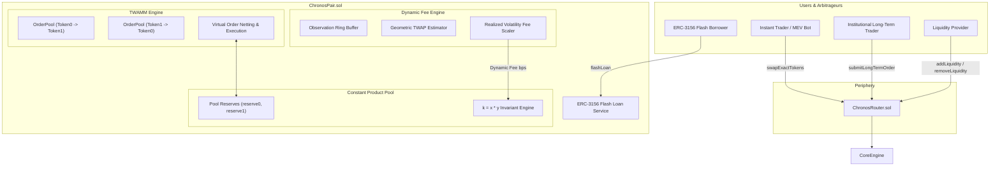

# Chronos AMM Core (`chronos-amm-core`)

[![Foundry][foundry-badge]][foundry-url]
[![License: MIT][license-badge]][license-url]
[![Solidity][solidity-badge]][solidity-url]

> High-performance, constant-product Automated Market Maker (AMM) engine combining **Time-Weighted Average Market Maker (TWAMM)** lazy virtual execution, **LVR-mitigating dynamic volatility fees**, and **ERC-3156 flash loans** written in modern Solidity (`0.8.26`).

---

## Architecture Overview

`chronos-amm-core` unites classical Constant Product AMM liquidity ($x \cdot y = k$) with long-term time-weighted order streaming and adaptive dynamic fee scaling to address the two greatest structural challenges in decentralized exchange design:
1. **Execution Slippage on Large Flows**: Long-term trades are fractured into continuous virtual order streams executing across discrete epoch intervals, netting bilateral counter-flows with near-zero price impact.
2. **Loss-Versus-Rebalancing (LVR) & Toxic MEV**: A geometric TWAP and realized price variance engine dynamically scales swap fees up to 150 bps during market turbulence to compensate passive liquidity providers.



---

## Core Technical Features

### 1. TWAMM (Time-Weighted Average Market Maker) Virtual Engine
- **Lazy Evaluation**: Virtual orders do not require background cron-jobs or block-by-block transactions. State updates lazily upon the next interaction (`swap`, `mint`, `burn`, `executeTwamm`), executing all elapsed intervals in $O(\Delta \text{intervals})$.
- **Bilateral Order Netting**: In intervals where both token 0 $\to$ token 1 and token 1 $\to$ token 0 virtual orders are active, the opposing flows cross directly against each other at the marginal pool price without draining pool reserves or incurring unnecessary price impact.
- **Fair Reward Accounting**: Uses an accumulated `rewardFactor` (cumulative purchased tokens per unit of active sales rate, analogous to MasterChef/Staking pools) enabling $O(1)$ token claims and flexible order cancellations with exact proportional refunds of unexecuted tokens.

### 2. Loss-Versus-Rebalancing (LVR) Dynamic Fee Curve
- **Ring Buffer Observations**: Tracks historical cumulative prices across rolling observation windows.
- **Short-Term Realized Volatility ($\sigma$)**: Measures deviation between instantaneous interval prices and the moving TWAP.
- **Fee Scaling Formulation**:
  $$\text{Fee}_{\text{bps}} = \min\left(\text{MaxFee}, \max\left(\text{MinFee}, \text{BaseFee} + \frac{|\Delta P|}{P} \cdot \alpha\right)\right)$$
  - Base Fee: `30 bps` (0.30%)
  - Min Fee: `5 bps` (0.05%)
  - Max Fee: `150 bps` (1.50%)
- Protects liquidity providers from toxic flow during high volatility while keeping fees ultra-competitive during stable regimes.

### 3. ERC-3156 Compliant Flash Lending
- Implements `IERC3156FlashLender` directly in the core pool.
- Allows uncollateralized atomic loans of either token up to full pool reserves.
- Enforces strict reentrancy protection and verifies post-callback reserve solvency ($r_{\text{post}} \ge r_{\text{pre}} + \text{fee}$).

### 4. Mathematical Precision & Safety
- Custom `ChronosMath` library provides Wad ($10^{18}$) and Ray ($10^{27}$) fixed-point multiplication and division with optimal rounding.
- High-efficiency Babylonian integer square root algorithm with full precision.
- EIP-2612 `permit` implementation with EIP-2 signature malleability rejection ($s \le \text{secp256k1n}/2$).
- Zero-address and reentrancy guards protecting against reentrancy attacks and phantom yield exploits.

---

## Repository Structure

```
chronos-amm-core/
├── src/
│   ├── ChronosERC20.sol          # LP token with EIP-2612 permit
│   ├── ChronosFactory.sol        # CREATE2 pair deployer and fee registry
│   ├── ChronosPair.sol           # Core AMM, TWAMM virtual engine & ERC-3156 lender
│   ├── ChronosRouter.sol         # Multi-hop router with slippage & deadline checks
│   ├── interfaces/
│   │   ├── IChronosCallee.sol
│   │   ├── IChronosFactory.sol
│   │   ├── IChronosPair.sol
│   │   ├── IERC20.sol
│   │   ├── IERC3156FlashBorrower.sol
│   │   └── IERC3156FlashLender.sol
│   └── libraries/
│       ├── ChronosMath.sol       # Fixed-point math, sqrt & virtual swap netting
│       ├── SafeTransferLib.sol   # Gas-optimized safe low-level token transfers
│       └── VolatilityFee.sol     # TWAP ring buffer & dynamic fee calculator
├── test/
│   ├── ChronosInvariants.t.sol   # Stateful invariant fuzzing suite
│   ├── ChronosMath.t.sol         # Mathematical unit & fuzz tests
│   ├── ChronosPair.t.sol         # Core pair, TWAMM & flash loan integration tests
│   ├── ChronosRouter.t.sol       # Multi-hop routing & liquidity tests
│   └── mocks/
│       ├── MockCallee.sol
│       ├── MockERC20.sol
│       └── MockFlashBorrower.sol
├── foundry.toml                  # Foundry workspace configuration
├── LICENSE                       # MIT License
└── README.md
```

---

## Contract Size & Gas Profiling

Compiled with Solc `0.8.26` via Yul IR (`via_ir = true`, `optimizer_runs = 200`):

| Contract | Runtime Size (Bytes) | Initcode Size (Bytes) | Runtime Margin (to 24KB limit) |
| :--- | :--- | :--- | :--- |
| **`ChronosPair`** | **13,438 B** | 13,755 B | **+11,138 B (45.3% headroom)** |
| **`ChronosFactory`** | **15,165 B** | 15,322 B | **+9,411 B (38.3% headroom)** |
| **`ChronosRouter`** | **4,668 B** | 4,863 B | **+19,908 B (81.0% headroom)** |

---

## Verification & Quality Gates

The test suite contains **18 automated test suites** covering mathematical boundary cases, fuzz runs, property invariants, and integration flows:

```bash
# Run unit and fuzz tests with execution traces
forge test -vvv --fuzz-runs 256

# Run stateful invariant testing
forge test --match-contract ChronosInvariantsTest

# Check contract bytecode limits
forge build --sizes

# Verify code formatting
forge fmt --check
```

### Invariants Verified:
- **`invariant_SolvencyToken0`**: Physical balance of `token0` $\ge$ `reserve0` + `orderPool0Balance` under all sequence permutations.
- **`invariant_SolvencyToken1`**: Physical balance of `token1` $\ge$ `reserve1` + `orderPool1Balance`.
- **`invariant_MinimumLiquidityLocked`**: Permanent liquidity burned to `address(0)` $\ge 1000$ wei.

---

## Design Trade-offs & Known Limitations

1. **Epoch Interval Granularity**: The default `INTERVAL_LENGTH` is set to 10 seconds. Shorter intervals increase order matching frequency and execution smoothness at the expense of computational loop iterations when lazily catching up across long periods of inactivity.
2. **Flash Loan Invariant Verification**: Flash loans require standard ERC-3156 tokens; fee payments must occur in the borrowed token currency.
3. **Price Manipulation Resistance**: The dynamic fee engine uses multi-observation geometric TWAP accumulators. For production deployment on low-liquidity L2 networks with sequencer time-drifts, oracle integration with Chainlink or Pyth can be configured as a secondary safety floor.

---

## License

This project is licensed under the [MIT License](LICENSE).

[foundry-badge]: https://img.shields.io/badge/Built%20with-Foundry-FF4400.svg
[foundry-url]: https://getfoundry.sh/
[license-badge]: https://img.shields.io/badge/License-MIT-blue.svg
[license-url]: LICENSE
[solidity-badge]: https://img.shields.io/badge/Solidity-0.8.26-363636.svg
[solidity-url]: https://soliditylang.org/
